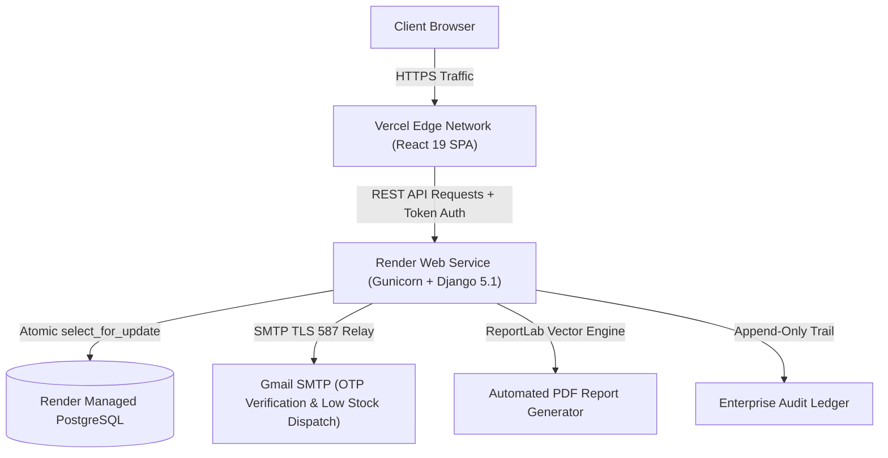

# Minu Marketing - Enterprise Inventory Management System (IMS)

An enterprise-grade, high-concurrency inventory telemetry, auditable ledger, automated threshold alert engine, interactive product onboarding tour, and role-based access control (RBAC) suite. Built strictly to modern production standards with **Django 5.1 REST Framework** (Python 3.12+) and **React.js 19 (Vite, JavaScript ES6+)** using a custom iBanko-inspired modern design system.

---

## 🌐 Live Production Deployments

| Component | Platform | Live URL / Endpoint | Status |
| :--- | :--- | :--- | :--- |
| **Frontend Web App** | **Vercel** | [https://minu-marketing.vercel.app](https://minu-marketing.vercel.app) | 🟢 Live & Auto-Deploys |
| **Backend REST API** | **Render** | [https://minu-marketing.onrender.com/api/v1/](https://minu-marketing.onrender.com/api/v1/) | 🟢 Live & Auto-Deploys |
| **PostgreSQL Database** | **Render DB** | `minu-marketing-db` (AWS Frankfurt) | 🟢 High-Availability Managed |
| **Interactive Docs** | **Swagger UI** | [https://minu-marketing.onrender.com/api/docs/](https://minu-marketing.onrender.com/api/docs/) | 🟢 OpenAPI 3.0 |

---

## 🏗️ Architecture & Production Infrastructure

The application uses an enterprise decoupled architecture with zero-latency updates and automated continuous integration (CI/CD):



### Production Hosting Overview:
1. **Frontend (Vercel)**:
   - Hosted directly from the `frontend/` directory of the `main` branch.
   - Built using Vite with minification, asset hash generation, and optimized chunking.
   - SPA routing handled through `vercel.json` rewrites (`"destination": "/index.html"`).
   - Configured with environment variable `VITE_API_URL=https://minu-marketing.onrender.com`.

2. **Backend (Render Web Service)**:
   - Continuous deployment triggered automatically from `main` branch pushes.
   - Automated `./build.sh` pipeline executes dependency installation (`pip install -r requirements.txt`), Django database migrations (`python manage.py migrate`), static collection (`collectstatic`), and default demo seed data generation (`python manage.py seed_data`).
   - Served via **Gunicorn** WSGI with multi-worker concurrency.
   - Connected via secure `DATABASE_URL` to managed Render PostgreSQL instance.

---

## ⚡ Key Capabilities & Features

### 1. Interactive Onboarding & Feature Discovery Tour
- **Role-Aware Interactive Walkthrough**: Automatically introduces new team members based on permissions (Admin, Manager, Operator, Viewer).
- **Celebratory Milestones**: Centered completion badge and animated multi-colored celebration confetti burst on finishing the tour.
- **Getting Started Checklist**: Interactive tasks with click-to-navigate links, active state pulsing, and auto-dismissal once orientation is complete.
- **Individual Profile Avatars**: User-scoped custom avatar photo uploads stored independently per account.

### 2. Catalog & Product Lifecycle Management
- Enforced database-level SKU uniqueness.
- Comprehensive CRUD with instant category allocation and supplier attribution.
- Soft-archive and restoration safety mechanisms to prevent broken transaction histories.
- Real-time instant search by SKU, title, and category with zero layout reflow.

### 3. Concurrency-Safe Stock Ledger (Append-Only)
- Concurrency-safe atomic transactions (`STOCK_IN`, `STOCK_OUT`, `ADJUSTMENT`).
- Row-level database locks (`select_for_update`) to prevent double-spending race conditions.
- Strict database constraints guaranteeing inventory never dips below zero.
- Complete mutation audit trail tracking operator credentials, reference numbers, and timestamps.

### 4. Automated Replenishment & Threshold Alerts
- Real-time event-driven alert triggers for **Low Stock** and **Out of Stock**.
- Individual per-product configurable threshold trigger levels.
- State machine workflow: `Active` &rarr; `Acknowledged` &rarr; `Resolved`.
- Automatic deduplication and automated resolution upon restocking.
- One-click **Download PDF Requisition Report** (powered by ReportLab) and sanitized CSV export.

### 5. Organization & Employee Access Control (RBAC)
- Built-in multi-tier access privileges:
  - **Administrator**: Full system authority, team management, catalog modifications.
  - **Inventory Manager**: Stock intake/dispatch, catalog updates, alert thresholds.
  - **Inventory Operator**: Warehouse operations, stock-in and dispatch transactions.
  - **Read-Only Viewer**: Auditing, inventory valuation inspection, read-only analytics.
- Self-role change protection and root account deactivation prevention.
- One-click account activation / deactivation toggling.

### 6. Multi-Factor OTP & Security Architecture
- 6-digit cryptographic OTP verification via Gmail SMTP relay (`smtp.gmail.com:587`).
- Self-signup with email verification and secure self-service password reset.
- Sanitized CSV export mitigating CSV Formula Injection attacks (`=`, `+`, `-`, `@`).
- Constant-time password hashing and DRF Token Authentication supporting cross-origin sessions across Vercel & Render.

---

## 💻 Technology Stack

| Layer | Technologies |
| :--- | :--- |
| **Frontend** | React 19, Vite, Canvas-Confetti, Lucide Icons, Recharts, Custom CSS Design System |
| **Backend** | Python 3.12, Django 5.1, Django REST Framework, Django-Filter, django-cors-headers, Gunicorn |
| **Database** | PostgreSQL (Render Managed DB), Django ORM with Atomic Row Locks |
| **Security & Email** | Token Auth, Session Auth, CSRF Protection, Gmail SMTP Relay, EmailOTP |
| **Reports** | ReportLab PDF Engine, Sanitized CSV Streaming |
| **Cloud Hosting** | **Vercel** (Frontend SPA Edge CDN), **Render** (Backend Web Service & PostgreSQL) |
| **API Docs** | OpenAPI 3.0 via `drf-spectacular` & Swagger UI (`/api/docs/`) |

---

## 🚀 How It Is Hosted: Step-by-Step Guide

### A. How the Backend is Hosted on Render
1. A **Web Service** named `minu-marketing` is connected to the GitHub repository [ajayroll1/Minu-Marketing](https://github.com/ajayroll1/Minu-Marketing).
2. A managed **PostgreSQL** database named `minu-marketing-db` is provisioned on Render.
3. The Build Command is configured as:
   ```bash
   ./build.sh
   ```
   *`build.sh` automatically installs Python requirements, runs migrations on PostgreSQL, collects static files, and executes `seed_data`.*
4. The Start Command is:
   ```bash
   gunicorn project.wsgi:application --bind 0.0.0.0:$PORT --workers 3
   ```
5. Environment Variables configured on Render:
   - `PYTHON_VERSION`: `3.11.9`
   - `DJANGO_DEBUG`: `False`
   - `DJANGO_SECRET_KEY`: `<production-secret-key>`
   - `DATABASE_URL`: `<Internal Connection String from Render Postgres>`
   - `DJANGO_ALLOWED_HOSTS`: `.onrender.com,localhost,127.0.0.1`
   - `CORS_ALLOWED_ORIGINS`: `https://minu-marketing.vercel.app,http://localhost:5173`
   - `CSRF_TRUSTED_ORIGINS`: `https://*.onrender.com,https://minu-marketing.vercel.app`
   - `SMTP_HOST`: `smtp.gmail.com`
   - `SMTP_PORT`: `587`
   - `SMTP_USER`: `ajaymahto2580@gmail.com`
   - `SMTP_PASS`: `<app-specific-password>`
   - `SMTP_FROM_EMAIL`: `Minu Marketing Notifications <ajaymahto2580@gmail.com>`

---

### B. How the Frontend is Hosted on Vercel
1. The GitHub repository is imported into **Vercel**.
2. **Root Directory** is configured to `frontend`.
3. Framework preset is detected as **Vite**.
4. Build Command: `npm run build` (outputs to `dist`).
5. Environment Variable configured in Vercel:
   - `VITE_API_URL`: `https://minu-marketing.onrender.com`
6. `frontend/vercel.json` ensures all client-side routes (like deep links) properly resolve without 404s:
   ```json
   {
     "rewrites": [
       { "source": "/(.*)", "destination": "/index.html" }
     ]
   }
   ```

---

## 🛠️ Local Development Setup

### 1. Clone Repository
```bash
git clone https://github.com/ajayroll1/Minu-Marketing.git
cd Minu-Marketing
```

### 2. Backend Setup (Django)
```bash
# Setup virtual environment
python -m venv venv
# On Windows:
.\venv\Scripts\Activate.ps1
# On macOS/Linux:
source venv/bin/activate

# Install dependencies
pip install -r requirements.txt

# Run migrations and seed data
python manage.py migrate
python manage.py seed_data

# Start local server (port 8000)
python manage.py runserver
```

### 3. Frontend Setup (React Vite)
```bash
cd frontend
npm install
npm run dev
# Vite runs at http://localhost:5173
```

---

## 🔑 Demo & Testing Credentials

Use any of these pre-seeded accounts to explore the system across different RBAC permissions:

| Role | Username | Password | Access Privileges |
| :--- | :--- | :--- | :--- |
| **Administrator** | `admin` | `Admin12345!` | Full system control, employee RBAC, audit log inspection |
| **Inventory Manager** | `manager` | `Manager12345!` | Catalog management, custom alert limits, stock operations |
| **Inventory Operator** | `operator` | `Operator12345!` | Stock intake, dispatches, physical warehouse tasks |
| **Read-Only Viewer** | `viewer` | `Viewer12345!` | Analytics viewing, valuation telemetry, read-only audits |

---

## 🧪 Automated Testing Suite

Verify backend business rules, atomic stock operations, and RBAC permissions:

```bash
pytest app/tests.py -v
```

---

## 📄 License & Attribution

Designed and engineered for **Minu Marketing**. Proprietary enterprise software. All rights reserved.