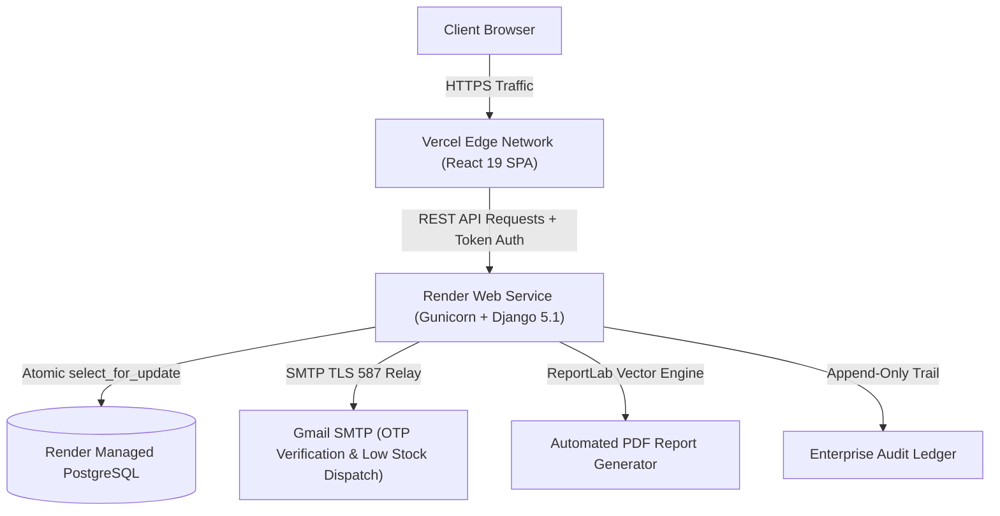

# Minu Marketing - Enterprise Inventory Management System (IMS)

An enterprise-grade, high-concurrency inventory telemetry, auditable ledger, automated threshold alert engine, interactive product onboarding tour, and strict Role-Based Access Control (RBAC) suite. Built strictly to modern production standards with **Django 5.1 REST Framework** (Python 3.12+) and **React.js 19 (Vite, JavaScript ES6+)** using a custom iBanko-inspired modern design system.

---

## 🌐 Live Production Deployments

| Component | Platform | Live URL / Endpoint | Status |
| :--- | :--- | :--- | :--- |
| **Frontend Web App** | **Vercel** | [https://minu-marketing.vercel.app](https://minu-marketing.vercel.app) | 🟢 Live & Auto-Deploys |
| **Backend REST API** | **Render** | [https://minu-marketing.onrender.com/api/v1/](https://minu-marketing.onrender.com/api/v1/) | 🟢 Live & Auto-Deploys |
| **PostgreSQL Database** | **Render DB** | `minu-marketing-db` (AWS Frankfurt) | 🟢 High-Availability Managed |
| **Interactive Docs** | **Swagger UI** | [https://minu-marketing.onrender.com/api/docs/](https://minu-marketing.onrender.com/api/docs/) | 🟢 OpenAPI 3.0 |

---

## 🏗️ System Architecture & Production Infrastructure

The application uses an enterprise decoupled architecture with zero-latency updates and automated continuous integration (CI/CD):



### Production Hosting Overview:
1. **Frontend (Vercel)**:
   - Hosted directly from the `frontend/` directory of the `main` branch.
   - Built using Vite with minification, asset hash generation, and optimized chunking.
   - SPA routing handled through `vercel.json` rewrites (`"destination": "/index.html"`).
   - Configured with environment variable `VITE_API_URL=https://minu-marketing.onrender.com`.

2. **Backend (Render Web Service)**:
   - Continuous deployment triggered automatically from `main` branch pushes.
   - Automated `./build.sh` pipeline executes dependency installation (`pip install -r requirements.txt`), Django database migrations (`python manage.py migrate`), static collection (`collectstatic`), and default demo seed data generation (`python manage.py seed_data`).
   - Served via **Gunicorn** WSGI with multi-worker concurrency.
   - Connected via secure `DATABASE_URL` to managed Render PostgreSQL instance.

---

## ⚡ Key Capabilities & Feature Highlights

### 1. Enterprise RBAC & Employee Provisioning
- **Strict Role-Based Access Control**:
  - **Administrator**: Full system authority, employee provisioning, role assignment, audit log inspection.
  - **Inventory Manager**: Stock intake/dispatch, catalog updates, per-product alert thresholds.
  - **Inventory Operator**: Warehouse operations, physical stock-in, and dispatch transactions.
  - **Read-Only Viewer**: Auditing, inventory valuation inspection, read-only analytics.
- **Admin-Controlled Staff Provisioning**: Self-signups are disabled on login to enforce strict enterprise security. Only Administrators can provision new employees through the **"+ Add Employee"** modal.
- **Protected Master Accounts**: Built-in safeguards prevent self-deactivation or accidental demotion of the primary administrator account.

### 2. Interactive Onboarding & Feature Discovery Tour
- **Role-Aware Interactive Walkthrough**: Automatically introduces new team members based on their specific permissions.
- **Celebratory Milestones**: Centered completion badge and animated multi-colored celebration confetti burst on finishing the tour.
- **Getting Started Checklist**: Interactive tasks with click-to-navigate links, active state pulsing, and auto-dismissal once orientation is complete.
- **Individual Profile Avatars**: User-scoped custom avatar photo uploads stored independently per account.

### 3. Concurrency-Safe Stock Ledger (Append-Only)
- Concurrency-safe atomic transactions (`STOCK_IN`, `STOCK_OUT`, `ADJUSTMENT`).
- Row-level database locks (`select_for_update`) to prevent double-spending race conditions.
- Strict database constraints guaranteeing inventory never dips below zero.
- Complete mutation audit trail tracking operator credentials, reference numbers, and timestamps.

### 4. Automated Replenishment & Threshold Alerts
- Real-time event-driven alert triggers for **Low Stock** and **Out of Stock**.
- Individual per-product configurable threshold trigger levels.
- State machine workflow: `Active` &rarr; `Acknowledged` &rarr; `Resolved`.
- Automatic deduplication and automated resolution upon restocking.
- One-click **Download PDF Requisition Report** (powered by ReportLab) and sanitized CSV export.

### 5. Multi-Factor OTP & Security Architecture
- 6-digit cryptographic OTP verification via Gmail SMTP relay (`smtp.gmail.com:587`).
- Self-service password recovery with email verification OTP.
- Sanitized CSV export mitigating CSV Formula Injection attacks (`=`, `+`, `-`, `@`).
- Constant-time password hashing and DRF Token Authentication supporting cross-origin sessions across Vercel & Render.

---

## 💻 Technology Stack

| Layer | Technologies |
| :--- | :--- |
| **Frontend** | React 19, Vite, Canvas-Confetti, Lucide Icons, Recharts, Custom CSS Design System |
| **Backend** | Python 3.12, Django 5.1, Django REST Framework, Django-Filter, django-cors-headers, Gunicorn |
| **Database** | PostgreSQL (Render Managed DB), Django ORM with Atomic Row Locks |
| **Security & Email** | Token Auth, Session Auth, CSRF Protection, Gmail SMTP Relay, EmailOTP |
| **Reports** | ReportLab PDF Engine, Sanitized CSV Streaming |
| **Cloud Hosting** | **Vercel** (Frontend SPA Edge CDN), **Render** (Backend Web Service & PostgreSQL) |
| **API Docs** | OpenAPI 3.0 via `drf-spectacular` & Swagger UI (`/api/docs/`) |

---

## 🚀 How It Is Hosted: Step-by-Step Guide

### A. Backend on Render
1. A **Web Service** named `minu-marketing` is connected to the GitHub repository [ajayroll1/Minu-Marketing](https://github.com/ajayroll1/Minu-Marketing).
2. A managed **PostgreSQL** database named `minu-marketing-db` is provisioned on Render.
3. The Build Command is configured as:
   ```bash
   ./build.sh
   ```
   *`build.sh` automatically installs Python requirements, runs migrations on PostgreSQL, collects static files, and executes `seed_data`.*
4. The Start Command is:
   ```bash
   gunicorn project.wsgi:application --bind 0.0.0.0:$PORT --workers 3
   ```
5. Environment Variables configured on Render:
   - `PYTHON_VERSION`: `3.11.9`
   - `DJANGO_DEBUG`: `False`
   - `DJANGO_SECRET_KEY`: `<production-secret-key>`
   - `DATABASE_URL`: `<Internal Connection String from Render Postgres>`
   - `DJANGO_ALLOWED_HOSTS`: `.onrender.com,localhost,127.0.0.1`
   - `CORS_ALLOWED_ORIGINS`: `https://minu-marketing.vercel.app,http://localhost:5173`
   - `CSRF_TRUSTED_ORIGINS`: `https://*.onrender.com,https://minu-marketing.vercel.app`
   - `SMTP_HOST`: `smtp.gmail.com`
   - `SMTP_PORT`: `587`
   - `SMTP_USER`: `ajaymahto2580@gmail.com`
   - `SMTP_PASS`: `<app-specific-password>`
   - `SMTP_FROM_EMAIL`: `Minu Marketing Notifications <ajaymahto2580@gmail.com>`

---

### B. Frontend on Vercel
1. The GitHub repository is imported into **Vercel**.
2. **Root Directory** is configured to `frontend`.
3. Framework preset is detected as **Vite**.
4. Build Command: `npm run build` (outputs to `dist`).
5. Environment Variable configured in Vercel:
   - `VITE_API_URL`: `https://minu-marketing.onrender.com`
6. `frontend/vercel.json` ensures all client-side routes (like deep links) properly resolve without 404s:
   ```json
   {
     "rewrites": [
       { "source": "/(.*)", "destination": "/index.html" }
     ]
   }
   ```

---

## 🛠️ Complete Installation & Local Run Guide

### 1. Prerequisites
- **Git**
- **Python 3.10+** (Python 3.11 or 3.12 recommended)
- **Node.js 18+** and **npm 9+**

---

### 2. Clone Repository
```bash
git clone https://github.com/ajayroll1/Minu-Marketing.git
cd Minu-Marketing
```

---

### 3. Backend Setup (Django)

1. **Create and activate a virtual environment**:
   ```bash
   # On Windows (PowerShell):
   python -m venv venv
   .\venv\Scripts\Activate.ps1

   # On macOS/Linux:
   python3 -m venv venv
   source venv/bin/activate
   ```

2. **Install Python dependencies**:
   ```bash
   pip install -r requirements.txt
   ```

3. **Configure environment variables**:
   Create a `.env` file in the project root:
   ```env
   DEBUG=True
   SECRET_KEY=local-dev-secret-key-change-in-production
   ALLOWED_HOSTS=localhost,127.0.0.1

   # Email SMTP (Gmail App Password)
   SMTP_HOST=smtp.gmail.com
   SMTP_PORT=587
   SMTP_USER=your_email@gmail.com
   SMTP_PASS=your_app_password
   SMTP_FROM_EMAIL=Minu Marketing <your_email@gmail.com>
   ```

4. **Apply database migrations and populate seed demo data**:
   ```bash
   python manage.py migrate
   python manage.py seed_data
   ```

5. **Start Django development server**:
   ```bash
   python manage.py runserver
   # Backend API will be available at http://127.0.0.1:8000/api/v1/
   ```

---

### 4. Frontend Setup (React Vite)

1. **Open a new terminal window** and navigate to `frontend`:
   ```bash
   cd frontend
   ```

2. **Install Node packages**:
   ```bash
   npm install
   ```

3. **Configure local environment (optional)**:
   In `frontend/.env.development` or by default, it connects to `http://127.0.0.1:8000`.

4. **Start Vite development server**:
   ```bash
   npm run dev
   # Frontend will be live at http://localhost:5173
   ```

5. **Build for production**:
   ```bash
   npm run build
   # Compiled assets will be output in frontend/dist/
   ```

---

## 🔑 Demo & Testing Credentials

Use any of these pre-seeded accounts to explore the system across different RBAC permissions:

| Role | Username | Password | Access Privileges |
| :--- | :--- | :--- | :--- |
| **Administrator** | `admin` | `Admin12345!` | Full system control, employee provisioning, audit log inspection |
| **Inventory Manager** | `manager` | `Manager12345!` | Catalog management, custom alert limits, stock operations |
| **Inventory Operator** | `operator` | `Operator12345!` | Stock intake, dispatches, physical warehouse tasks |
| **Read-Only Viewer** | `viewer` | `Viewer12345!` | Analytics viewing, valuation telemetry, read-only audits |

---

## 📖 How to Use the Application: User Workflow

1. **Login & Role Selection**:
   - Navigate to [https://minu-marketing.vercel.app](https://minu-marketing.vercel.app).
   - Click any **Quick Demo Role** button (Admin, Manager, Operator, Viewer) to autofill credentials, or enter custom login credentials.
2. **Interactive Onboarding Tour**:
   - First-time logins will automatically be greeted with the **Interactive Product Tour**.
   - Step through the interactive spotlights or click **"Replay Interactive Tour"** from the top header anytime.
   - Upon completion, enjoy the celebration confetti animation!
3. **Inventory Dashboard**:
   - Review live aggregated inventory valuation, active SKU count, and low-stock indicators.
   - Use **Quick Stock In / Dispatch** buttons on the dashboard for rapid stock movement.
4. **Product Catalog**:
   - Search by SKU, title, or category.
   - Add new SKUs, modify safety stock thresholds, or soft-archive obsolete items.
   - Export sanitized catalog CSVs.
5. **Stock Movement Ledger**:
   - Inspect append-only transactional audit trail.
   - Filter transactions by type (`STOCK_IN`, `STOCK_OUT`, `ADJUSTMENT`) or search by reference invoice numbers.
6. **Automated Alert Settings & Requisitions**:
   - Set individual threshold trigger quantities per SKU.
   - Acknowledge or resolve low-stock alerts.
   - Download professional **PDF Requisition Reports** generated on-the-fly via ReportLab.
7. **Employees & Team Directory (Admin Only)**:
   - Click **"+ Add Employee"** to provision new staff members with designated roles and initial passwords.
   - Promote/demote user roles or activate/deactivate accounts with one click.
8. **Audit Trail (Admin Only)**:
   - View an immutable timeline of every security event, role modification, and catalog edit.

---

## 🧪 Automated Testing Suite

Verify backend business rules, atomic stock operations, and RBAC permissions:

```bash
# Using virtual environment Python:
.\venv\Scripts\python.exe manage.py test app
```

---

## 📄 License & Attribution

Designed and engineered for **Minu Marketing**. Proprietary enterprise software. All rights reserved.