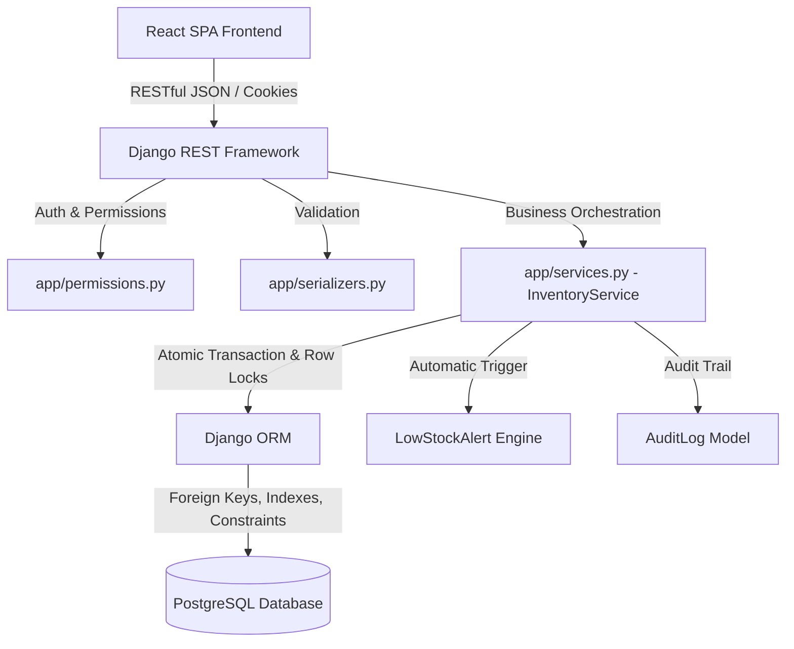

# System Architecture Document

## 1. High-Level Overview
The Inventory Management System (IMS) follows a clean, decoupled full-stack architecture:
- **Presentation Layer**: React.js (JavaScript ES6+, Vite, Recharts, Lucide Icons) built with solid color enterprise tokens (zero gradients).
- **Application & API Layer**: Python & Django REST Framework (DRF) organized under project `project` and application `app`.
- **Business Service Layer**: `app/services.py` containing transactional orchestration (`InventoryService`), atomic concurrency locks (`select_for_update`), and alert automation.
- **Data Persistence Layer**: PostgreSQL relational database with decimal monetary fields, strict constraints, and transaction isolation.

## 2. Modules & Responsibilities
- `project/settings.py`: Environment configuration, CORS, DRF policies, and PostgreSQL database settings.
- `app/models.py`: Relational models for `Product`, `Category`, `Supplier`, `StockTransaction`, `LowStockAlert`, `UserProfile`, and `AuditLog`.
- `app/services.py`: Implements `InventoryService` providing concurrency-safe operations for stock-in, stock-out, physical audit counts, and automated threshold alerts.
- `app/permissions.py`: Implements `RoleBasedPermission` enforcing strict role boundaries (`ADMIN`, `MANAGER`, `OPERATOR`, `VIEWER`).
- `app/views.py`: REST viewsets and endpoints for CRUD, dashboard aggregation, reports export, and authentication.
